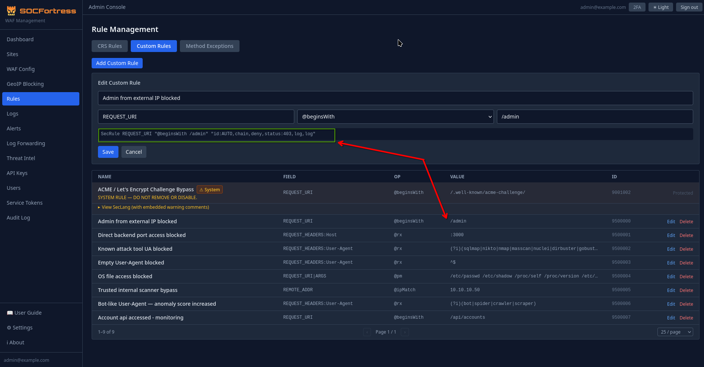
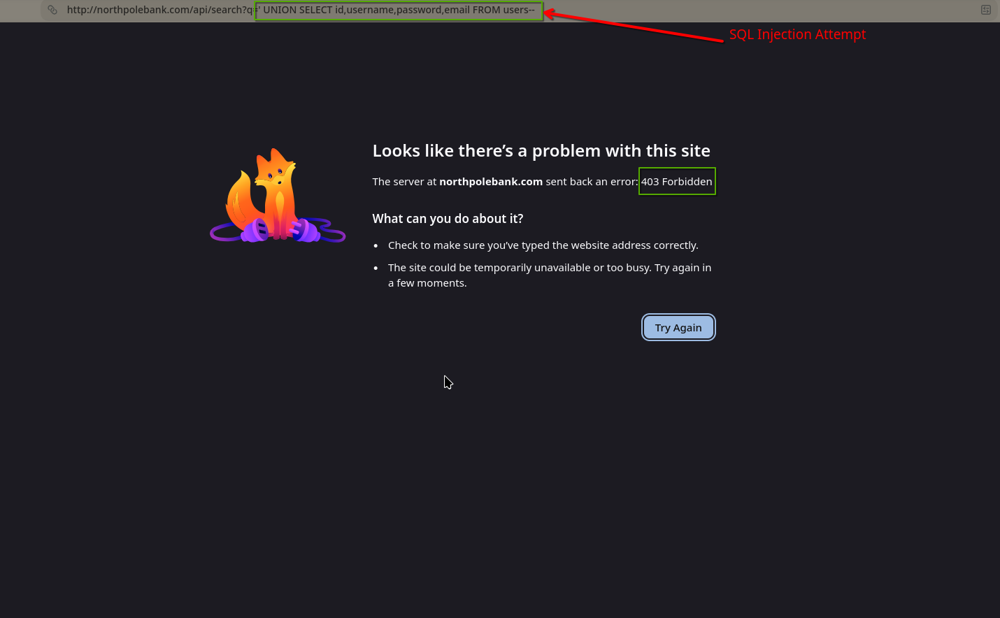
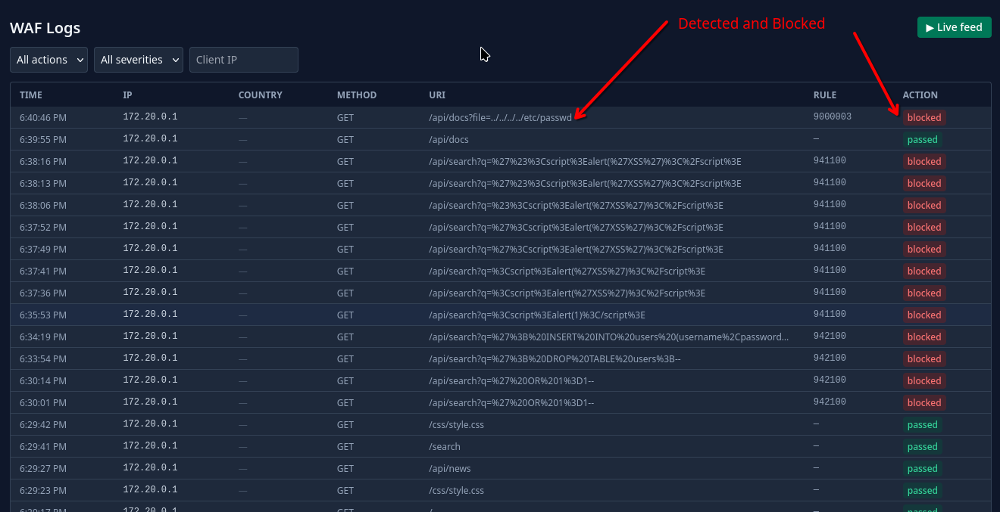
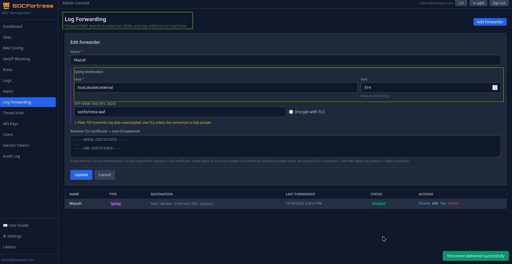
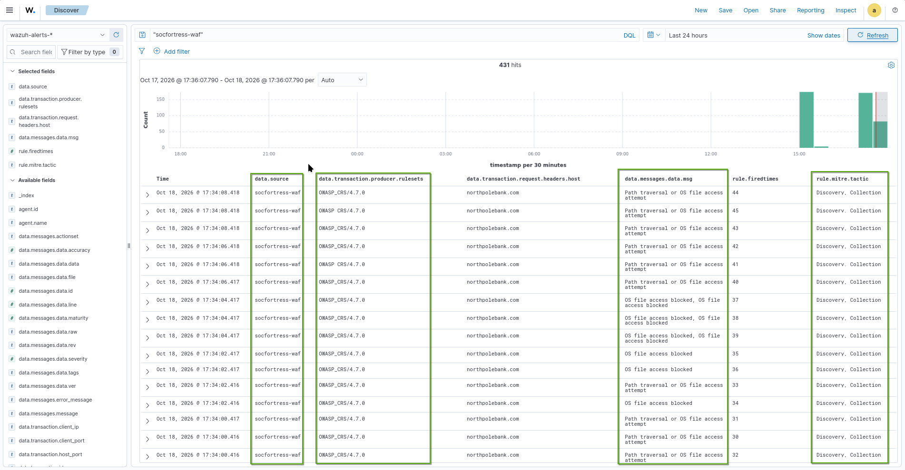

# Web Application Firewalls — A Practical Guide

Web application perimeter protection is one of the most fundamental concerns in application security. How do security engineers protect publicly exposed web applications from the constant flood of automated scans, injection attempts, and exploitation tools hitting them every day? One of the most common and most important answers to that question is a **Web Application Firewall (WAF)**.

WAFs are standard in modern security environments — found in cloud platforms, enterprise perimeters, and SOC toolkits alike. Understanding how they work, how rules are written, and where they fit in a broader security pipeline is essential knowledge for anyone in security engineering or blue team operations.

**NOTE**: This covers WAFs from first principles through to custom rule writing and SIEM integration, grounded in a real lab setup using **SocFortress WAF** (an open-source WAF built on Caddy + Coraza) protecting a deliberately vulnerable banking application, with events forwarding into **Wazuh**.

---

## What a WAF Actually Does

A WAF is not antivirus for a website. It does not scan application code. It does not know whether session management is secure or whether there are IDOR vulnerabilities in the codebase. A WAF only sees **HTTP traffic** — what arrives, and optionally what goes back out.

Every HTTP request that arrives gets examined against a set of rules. The WAF looks at the URL, the query parameters, the POST body, the headers, the cookies — anything that travels over HTTP. When something in that request matches a known attack pattern, the WAF can log it, block it, or both.

The critical word is *pattern*. A WAF is rule-based. It has no intelligence beyond the rules loaded into it. Good rules give good protection. No rules, and it is a transparent pipe.

---

## Reverse Proxy — Where the WAF Sits

Understanding a WAF requires first understanding **where** it sits in the traffic flow. A WAF operates as a **reverse proxy**.

There are two proxy types — forward and reverse — and they protect opposite ends of the connection.

### Forward Proxy

A forward proxy sits on the **client side**, acting as a middleman between the client and the internet.

```
You → [Forward Proxy] → Internet
```

Real-world analogy: asking a friend to buy something online on your behalf. The shop sees the friend's address, not yours. The client is hidden.

Common uses: VPNs, corporate internet filters, Tor.

### Reverse Proxy

A reverse proxy sits on the **server side**, acting as a middleman between the internet and the server.

```
User → [Reverse Proxy] → Your actual server
```

Real-world analogy: calling a company's main phone number. A receptionist answers, figures out what is needed, routes the call. The caller never gets the direct internal extension. The server's internal structure is hidden.

Common uses: load balancers, CDNs like Cloudflare, and WAFs.

A WAF is a reverse proxy. The user thinks they are communicating directly with the application. In reality they are communicating with the WAF. The WAF decides whether to forward the request to the application or terminate it.

The application never sees a SQLi payload, an XSS attempt, or a path traversal string. The WAF absorbed it before it arrived. This is the core value of the architecture — protection at the perimeter, transparent to the application behind it. Defence at the network edge means the application does not need to handle every possible attack vector itself.


---

## How Inspection Works

A WAF without rules is just an HTTP proxy. The rules define what gets blocked.

Most production WAFs use the **OWASP Core Rule Set (CRS)** as their baseline ruleset. The CRS is a community-maintained collection that covers the most common web attack classes: SQL injection, cross-site scripting, path traversal, remote code execution, protocol violations, scanner detection, and more. In the SocFortress setup, **Coraza** is the WAF engine — a modern Go implementation of ModSecurity running OWASP CRS v4.

When a request arrives, the WAF runs it through the loaded rules. Each rule is checking for a specific pattern in a specific part of the request.

### The Anomaly Scoring Model

The CRS does not block on every single rule match independently. Instead it uses an **anomaly scoring model** — a cumulative suspicion system.

Each rule is assigned a severity, and each severity maps to a point value:

| Severity | Points |
|---|---|
| CRITICAL | 5 |
| ERROR | 4 |
| WARNING | 3 |
| NOTICE | 2 |

Every time a rule fires, it adds its points to the request's running total. At the end of processing, if the total hits the configured threshold (the default is 5), the request is blocked. If it falls below, the request passes through.

A single CRITICAL hit adds 5 points, which immediately meets the default threshold of 5 and triggers a block. But the model also handles more subtle situations — a request with a suspicious user-agent (WARNING, +3) and a mildly odd header (NOTICE, +2) accumulates 5 points and gets blocked, even though neither signal alone would have been enough. This reflects how real attacks often look: not one glaring payload, but multiple indicators that together form a clear picture.

### Detection Mode vs Blocking Mode

WAFs operate in two modes:

**Detection mode** — rules fire and events are logged, but requests are not blocked. Traffic passes through regardless. This mode exists for tuning — seeing what the WAF would block before committing to blocking it.

**Blocking mode** — requests that hit or exceed the anomaly score threshold are returned a `403 Forbidden` response. Malicious traffic never reaches the application.

The right deployment sequence is always detection mode first. Running real application traffic through the WAF in detection mode reveals both genuine attack attempts and false positives — legitimate requests that happen to match a rule pattern. Exclusions get written for the false positives before switching to blocking mode.

---

## What a WAF Can and Cannot Block

This distinction matters more than almost anything else when working with WAFs.

### What a WAF blocks well

- **SQL Injection** — payloads like `' OR '1'='1' --` in form fields, URL parameters, or headers. The CRS uses libinjection, which understands SQL grammar rather than just matching keywords — making it effective against obfuscated payloads too.
- **Cross-Site Scripting (XSS)** — `<script>` tags, event handlers like `onerror=`, `javascript:` URIs, stored payloads submitted through contact forms or comment fields.
- **Path Traversal / LFI** — `../../../../etc/passwd` in file parameters, and their URL-encoded variants like `%2e%2e%2f`.
- **Known scanner signatures** — sqlmap, Nikto, Nmap, Gobuster, and similar tools all identify themselves in their User-Agent headers. The CRS recognises these signatures and blocks them.
- **Protocol violations** — malformed requests, oversized bodies, invalid HTTP methods.
- **Rate limiting** — custom rules can count requests or failed login attempts per IP and block once a threshold is exceeded.

### What a WAF cannot block

**IDOR (Insecure Direct Object Reference)** — when a logged-in user accesses another user's data by changing an ID in a request. Consider `/api/accounts?user_id=3`: a WAF sees a normal GET request with a number in the query string. There is no payload. There is nothing to detect. The request is syntactically and structurally valid. The only fix is in the application code — verifying that the requested `user_id` matches the authenticated user's session.

**Broken access control** — if an endpoint does not verify that the caller has the correct permissions, the WAF cannot determine that either. The request looks legitimate.

**Business logic flaws** — submitting a negative product quantity to get a refund, abusing a discount code more than once, manipulating workflow steps out of order. These are valid HTTP requests. Nothing in them resembles an attack pattern.

**Stolen valid session tokens** — once an attacker has a legitimate session cookie, their requests are indistinguishable from the real user's requests.

A WAF and secure application code are both required. The WAF handles the perimeter. The application handles its own logic and access control. Neither substitutes for the other.

---

## Custom Rules

The OWASP CRS is designed to be generic — it covers attack classes that affect any web application. But it has no knowledge of any specific application's structure, endpoints, or business logic.

It cannot:
- Block a specific IP that is hammering a login endpoint
- Allow a trusted third-party webhook to skip WAF inspection
- Restrict an `/admin` panel to internal network IPs only
- Rate-limit failed login attempts and block the IP after N failures
- Detect an attack pattern specific to one application's behaviour

Custom rules fill this gap. They use the same language as the CRS called **SecLang** (the directive language of ModSecurity and Coraza).

### SecLang Rule Structure

Every SecLang rule follows one structure:

```apache
SecRule  VARIABLE  "OPERATOR [value]"  "id:AUTO, phase:N, ACTION, msg:'description'"
```

Reading it as a sentence: *"If this VARIABLE matches this OPERATOR, perform these ACTIONS."*

An example:

```apache
SecRule REQUEST_HEADERS:User-Agent "@rx (?i)sqlmap" \
    "id:AUTO, phase:1, deny, status:403, log, msg:'sqlmap scanner blocked'"
```

Breaking it down:
- `REQUEST_HEADERS:User-Agent` — inspect the User-Agent header
- `@rx (?i)sqlmap` — match against the regex "sqlmap", case-insensitive
- `phase:1` — run during the request headers phase, before the body is read
- `deny` — block the request
- `status:403` — return HTTP 403 Forbidden
- `log` — write this event to the log
- `msg:` — the human-readable log message

> **NOTE:** Writing custom rules in SocFortress can be done in two ways — **structured** and **raw**. Structured mode is a form-based UI that covers common scenarios. Raw mode is the full SecLang interface — more flexible, supports rule chaining and all directive options, and is what this guide covers.

### Phases — When Rules Run

Rules are assigned to a phase that determines when in the request/response lifecycle they execute.

```
Request arrives
      │
  Phase 1  ← request headers available, body not yet read
      │         → suitable for: IP checks, URI checks, User-Agent, headers
  Phase 2  ← full request body available
      │         → suitable for: POST form data, JSON body, ARGS
  [Request forwarded to backend]
      │
  Phase 3  ← response headers available
  Phase 4  ← response body available
  Phase 5  ← logging phase, runs after response is sent
                → suitable for: incrementing counters based on response codes
```

Writing a rule in phase:1 that inspects `ARGS` (POST body parameters) will never match anything — the body has not been read yet. The rule will silently do nothing. The correct mapping: IP, URI, and header-based rules in **phase:1**; POST body, form fields, JSON in **phase:2**; response-code-based counters in **phase:5**.

### Variables

Variables are the parts of the HTTP transaction that rules can examine.

| Variable | What it inspects | Phase |
|---|---|---|
| `ARGS` | All GET params + POST params combined | 2 |
| `ARGS:name` | One specific named parameter | 2 |
| `REQUEST_URI` | Full path including query string | 1 |
| `REQUEST_FILENAME` | Path only, no query string | 1 |
| `REQUEST_METHOD` | GET, POST, PUT, DELETE, etc. | 1 |
| `REQUEST_HEADERS:Name` | A specific request header | 1 |
| `REQUEST_BODY` | The raw request body | 2 |
| `REMOTE_ADDR` | The client IP address | 1 |
| `RESPONSE_STATUS` | HTTP status code from the backend | 5 |
| `IP:varname` | A persistent per-IP counter variable | Any |
| `TX:varname` | A per-request transaction variable | Any |

The `IP:` variables are particularly useful for rate limiting. Unlike transaction variables, they persist across multiple requests from the same IP and only reset when their expiry time is reached.

### Operators — How to Match

The operator defines the comparison method used against the variable's value.

**`@rx`** — regular expression. The most flexible operator. The `(?i)` flag makes matching case-insensitive.
```apache
SecRule REQUEST_HEADERS:User-Agent "@rx (?i)(nikto|sqlmap|nmap)" ...
```

**`@streq`** — exact string equality. The variable must match the value character for character.
```apache
SecRule REQUEST_URI "@streq /api/internal/debug" ...
```

**`@contains`** — substring match. True if the value appears anywhere in the variable.
```apache
SecRule REQUEST_URI "@contains /etc/passwd" ...
```

**`@beginsWith`** / **`@endsWith`** — prefix or suffix matching.
```apache
SecRule REQUEST_URI "@beginsWith /admin" ...
SecRule REQUEST_FILENAME "@endsWith .bak" ...
```

**`@pm`** — parallel multi-string match using the Aho-Corasick algorithm. Checks against an entire list of strings in a single pass. Significantly faster than multiple `@contains` rules when building blocklists.
```apache
SecRule REQUEST_URI "@pm /etc/passwd /etc/shadow /proc/self .env .git .htaccess" ...
```

**`@detectSQLi`** — libinjection SQL injection detection. No value is supplied; libinjection tokenises the input and analyses it grammatically, detecting injection regardless of encoding or obfuscation.
```apache
SecRule ARGS "@detectSQLi" ...
```

**`@detectXSS`** — the same approach for XSS detection.

**`@ipMatch`** — IP address and CIDR range matching.
```apache
SecRule REMOTE_ADDR "@ipMatch 192.168.0.0/16,10.0.0.0/8,127.0.0.1" ...
```

**`@gt`** / **`@lt`** — numeric greater-than and less-than, used with counter variables.
```apache
SecRule IP:LOGIN_FAILURES "@gt 5" ...
```

Any operator can be **negated** with a `!` prefix — the rule fires when the condition is *not* true:
```apache
# Block if the source IP is NOT in the internal range
SecRule REMOTE_ADDR "!@ipMatch 192.168.0.0/16,10.0.0.0/8,127.0.0.1" ...
```

### Actions — The Response to a Match

Actions are comma-separated in the final quotes of a SecRule directive.

**`deny`** — block the request. Returns the status code set by `status:`.

**`pass`** — allow the request through and continue processing further rules. Used for logging without blocking, or for incrementing counters in detection mode.

**`allow`** — allow the request and **stop all further rule processing entirely**. Used for trusted bypass scenarios where a specific path should skip WAF inspection.

**`status:N`** — the HTTP response code on a `deny`. Common values: `403` (Forbidden), `429` (Too Many Requests for rate limiting), `405` (Method Not Allowed).

**`log`** / **`nolog`** — controls whether the match is written to the WAF log. High-frequency counter-increment rules should use `nolog` to avoid log flooding. Blocking rules should always use `log`.

**`msg:'text'`** — the log message. A descriptive message makes log analysis significantly faster. "SQLi attempt in username field on login endpoint" is useful. "Rule fired" is not.

**`tag:'category'`** — categorises the rule for log filtering. Multiple tags are allowed.

**`setvar:name=value`** — sets or modifies a variable. The foundation of rate limiting:
```apache
setvar:ip.login_failures=+1      # increment by 1
expirevar:ip.login_failures=60   # reset after 60 seconds
```

**`ctl:ruleEngine=Off`** — disables the WAF engine entirely for this request. Used in trusted webhook bypass rules.

### Transformations — Defeating Evasion

Consider a simple rule:
```apache
SecRule ARGS "@contains select" "deny"
```

This catches `select`. It misses `SELECT`, `SeLeCt`, `%73%65%6C%65%63%74` (URL-encoded), `&lt;select&gt;` (HTML-entity-encoded), and `SEL/**/ECT` (SQL comment-obfuscated). Attackers know what patterns WAFs look for and routinely encode payloads to slip past naive string matching.

**Transformations normalise the variable's value before the operator is applied.** They do not modify the actual request — only what the rule inspects.

```apache
SecRule ARGS "@contains select" \
    "id:AUTO, phase:2, deny, \
    t:urlDecodeUni, t:htmlEntityDecode, t:lowercase, t:replaceComments, \
    msg:'SQL keyword detected'"
```

With these transformations applied in order:
- `t:urlDecodeUni` — decodes `%73%65%6C%65%63%74` → `select`
- `t:htmlEntityDecode` — decodes `&lt;select&gt;` → `<select>`
- `t:lowercase` — converts `SELECT`, `SeLeCt` → `select`
- `t:replaceComments` — strips `SEL/**/ECT` → `SEL ECT`

Order matters. Decode transformations should come before normalisation transformations. Applying `t:lowercase` before `t:urlDecodeUni` means `%53ELECT` (uppercase S, URL-encoded) could slip through — the lowercase runs on the encoded form, not the decoded one.

Standard stacking for general injection rules:
```apache
t:urlDecodeUni, t:htmlEntityDecode, t:lowercase, t:replaceComments
```

For path traversal, add `t:normalizePath` which resolves `../` sequences after decoding, so `../../../../etc/passwd` and `%2e%2e%2f%2e%2e%2fetc%2fpasswd` both reduce to `/etc/passwd` before matching.

### Rule Chaining (AND Conditions)

Chaining links two or more rules such that the action only fires when **all conditions in the chain match**. It is logical AND.

Without chaining, this blocks every Python client:
```apache
SecRule REQUEST_HEADERS:User-Agent "@rx python-requests" \
    "id:AUTO, phase:1, deny, msg:'Python client blocked'"
```

The intent might be to block Python clients hitting the admin panel specifically:

```apache
SecRule REQUEST_HEADERS:User-Agent "@rx python-requests" \
    "id:AUTO, phase:1, chain, deny, status:403, log, msg:'Python client on admin'"
    SecRule REQUEST_URI "@beginsWith /admin" \
        ""
```

The `chain` action on the first rule defers the action. The `deny` only fires when both the User-Agent matches AND the URI starts with `/admin`. Python clients hitting other endpoints are unaffected.

Key rules for chained rules:
- `id:`, `phase:`, `msg:`, and the disruptive action (`deny`/`pass`/`allow`) go on the **first rule only**
- `chain` goes in the first rule's action list
- The final rule in the chain gets an empty action list `""`
- Three-condition chains add `chain` to the second rule as well

```apache
# Three conditions: scanner UA + admin path + external IP — all must be true
SecRule REQUEST_HEADERS:User-Agent "@rx (?i)(sqlmap|nikto)" \
    "id:AUTO, phase:1, chain, deny, status:403, log, msg:'Scanner on admin from external IP'"
    SecRule REQUEST_URI "@beginsWith /admin" \
        "chain"
        SecRule REMOTE_ADDR "!@ipMatch 10.0.0.0/8,192.168.0.0/16,127.0.0.1" \
            ""
```

Always include `127.0.0.1` in IP allowlists. Omitting it locks out local access during testing.

### Rate Limiting — Counting Across Requests

Rate limiting in SecLang requires two cooperating rules: one that counts, one that enforces.

```apache
# Phase 5: runs after the backend responds.
# Every time the backend returns a 401, increment this IP's failure counter.
SecRule RESPONSE_STATUS "@streq 401" \
    "id:AUTO, phase:5, pass, nolog, \
    setvar:ip.login_failures=+1, \
    expirevar:ip.login_failures=300, \
    msg:'Failed login counter incremented'"

# Phase 1: runs before the backend is reached.
# If this IP has accumulated more than 5 failures, block the next request.
SecRule IP:LOGIN_FAILURES "@gt 5" \
    "id:AUTO, phase:1, deny, status:429, log, \
    msg:'Brute force threshold exceeded — IP blocked for 5 minutes'"
```

The first rule runs in phase:5 — after the backend has responded. Every 401 (failed login) response increments the `ip.login_failures` counter for that IP. The `expirevar` sets a 300-second TTL — if the IP does not fail another login within 5 minutes, the counter resets. The second rule runs in phase:1 on every subsequent request from that IP. Once the counter exceeds 5, the request is blocked with a 429 before it reaches the backend at all.

---

## Putting Custom Rules Together — Real Deployed Examples

The following are the custom rules deployed in the SocFortress WAF lab, sitting on top of OWASP CRS.



### Blocking the Admin Panel from External IPs

```apache
SecRule REQUEST_URI "@beginsWith /admin" \
    "id:AUTO, phase:1, chain, deny, status:403, log, msg:'Admin from external IP blocked'"
    SecRule REMOTE_ADDR "!@ipMatch 192.168.0.0/16,10.0.0.0/8,127.0.0.1" \
        ""
```

Both conditions must be true simultaneously: the URI starts with `/admin` AND the source IP is not in an internal range. Internal users reach the admin panel normally. Anyone originating from outside the internal networks is blocked.

### Blocking Known Attack Tool User-Agents

```apache
SecRule REQUEST_HEADERS:User-Agent \
    "@rx (?i)(sqlmap|nikto|nmap|masscan|nuclei|dirbuster|gobuster|wfuzz|hydra|medusa)" \
    "id:AUTO, phase:1, deny, status:403, log, tag:'scanner', \
    msg:'Known attack tool UA blocked'"
```

These tools identify themselves in their User-Agent strings. sqlmap sends `sqlmap/1.7.8#stable`. Nikto sends `Nikto/2.1.6`. Blocking on User-Agent strings does not stop a determined attacker who changes their UA, but it stops the vast majority of automated scans without any further configuration.

### Blocking Empty User-Agents

```apache
SecRule REQUEST_HEADERS:User-Agent "@rx ^$" \
    "id:AUTO, phase:1, deny, status:403, log, tag:'automation', \
    msg:'Empty User-Agent blocked'"
```

Every real browser sends a User-Agent. Scripts and automation tools written hastily often omit it. An empty User-Agent string is a reliable indicator of non-browser traffic.

### Blocking OS File Access

```apache
SecRule REQUEST_URI|ARGS \
    "@pm /etc/passwd /etc/shadow /proc/self /proc/version /etc/hosts" \
    "id:AUTO, phase:1, deny, status:403, log, \
    t:urlDecodeUni, t:normalizePath, \
    tag:'lfi', msg:'OS file access blocked'"
```

`@pm` matches against all listed strings in a single pass. The transformations ensure that URL-encoded variants (`%2fetc%2fpasswd`) and path traversal sequences (`../../../../etc/passwd`) are decoded and normalised before matching, so both forms collapse to the same string and get caught by the same rule.

### Trusted Webhook Bypass

```apache
SecRule REQUEST_URI "@beginsWith /webhooks/stripe" \
    "id:AUTO, phase:1, allow, nolog, msg:'Stripe webhook WAF bypass'"
```

Third-party webhook payloads — Stripe, GitHub, and similar services — often contain JSON bodies with signatures and structured data that can trigger CRS rules as false positives. The `allow` action stops all further rule processing for requests to this path, letting them through to the application without inspection.

---

## Testing the WAF


*WAF blocking a SQL Injection attempt*


*SocFortress logs showing a Path Traversal attempt being caught*

Deploying a WAF and assuming it works is not a security posture. Testing with actual attack payloads is necessary to confirm what is being blocked, what the logged rule IDs are, and that the downstream SIEM is receiving events.

The testing approach in this lab used a Python script (`attack_simulation.py`) firing 57 payloads across 11 attack categories in configurable bursts, verifying three things per attack:

1. The HTTP response code matched what was expected (403, 429, etc.)
2. The event was recorded in the WAF's PostgreSQL database with the correct rule ID
3. A Wazuh SIEM alert was generated

Three-layer verification matters because each layer can fail independently. A WAF can block something without logging it. A SIEM integration can be silently misconfigured. HTTP 403 alone does not confirm the full pipeline is working.

### The IDOR Example

One of the test cases stands out because it demonstrates the limits of WAF protection more clearly than anything else.

The test sends `GET /api/accounts?user_id=3` while authenticated as a different user. The NorthBridge Bank backend does not validate that the requested `user_id` matches the authenticated session — it just returns the data. With the WAF in full blocking mode, this request goes through as a `200 OK` and returns another user's bank account data.

The WAF has nothing to detect. There is no injection payload. There is no suspicious encoding. There is no known attack signature. From the WAF's perspective, a logged-in user sent a normal GET request with a number in the query string. The request is structurally identical to a legitimate request.

The fix is in the application: `if (req.query.user_id !== req.session.user.id) return res.status(403)`. No WAF rule can substitute for that line of code.

---

## SIEM Integration — Forwarding WAF Events to Wazuh

A WAF that only blocks attacks and keeps that information to itself is only doing half the job. In real security operations, WAF events need to flow somewhere they can be alerted on, investigated, and correlated with other signals — a SIEM. A spike in SQLi attempts against a login endpoint, a single IP probing multiple attack vectors within seconds, a path traversal attempt followed by a brute force — these patterns only become visible when events are centralised.

The SocFortress WAF management platform has two distinct mechanisms for getting events out: **Log Forwarders** for raw event streaming to a SIEM or log aggregator, and **Alert Channels** for threshold-based notifications to messaging platforms or email. They serve different purposes and are typically used together.

### Log Forwarders

Log Forwarders push WAF events in near real-time to an external destination. The platform supports two transport types:

**Syslog over TLS** — sends structured syslog messages to a listening syslog receiver. This is the standard integration path for SIEM platforms like Wazuh, Splunk, or any ELK-based setup. The forwarder connects over TCP with optional TLS, sends each WAF event as a syslog message with a configurable app name (default: `waf-platform`), and supports custom CA certificates for environments with internal PKI.

**HTTPS** — posts event data to an HTTP endpoint with API key and secret authentication. This covers webhook-style integrations — custom pipelines, security automation platforms, or any destination that exposes an HTTP receiver.


*SocFortress log forwarding configuration*


*WAF logs arriving in Wazuh SIEM*

### Alert Channels and Rules

Alert Channels are a separate notification layer sitting on top of the PostgreSQL event store. Rather than streaming every event, they evaluate threshold-based conditions against event statistics and fire notifications when those thresholds are crossed.

The platform supports three channel types:

- **Email** — requires SMTP configuration (`SMTP_HOST`, `SMTP_PORT`, `SMTP_USER`, `SMTP_PASSWORD`, `SMTP_FROM` in `.env`)
- **Slack** — webhook URL integration
- **Webhook** — HTTP POST to any endpoint

Alert Rules define the conditions that trigger a notification. Each rule specifies:

- **`condition_type`** — one of `block_rate` (percentage of requests being blocked), `blocked_count` (absolute number of blocked requests), or `detected_count` (events detected but not blocked)
- **`threshold`** — the numeric value at which the rule fires
- **`window_minutes`** — the time window over which the condition is evaluated (1–60 minutes)
- **`severity`** — the label attached to the notification (INFO, WARNING, CRITICAL)
- **`channel_id`** — which notification channel to send to when the condition is met

A practical example: a rule with `condition_type: blocked_count`, `threshold: 50`, `window_minutes: 5` fires a notification if more than 50 requests are blocked within any 5-minute window — useful for catching active attack campaigns or unexpected traffic spikes without manually watching the log viewer.

Alert rules are distinct from WAF blocking rules. Blocking rules (SecLang) decide what happens to individual requests in real time. Alert rules watch aggregate statistics over time and notify when something unusual is happening at the traffic level.

---

## WAF Tuning — Managing False Positives

A WAF that generates excessive false positives and blocks legitimate users tends to get turned off. At that point there is no protection at all. Tuning is how the balance between detection effectiveness and operational impact gets maintained.

### The Paranoia Level

The OWASP CRS exposes a paranoia setting from 1 to 4:

- **Level 1** — core rules only. Catches the most prevalent attacks with the fewest false positives. The correct starting point for almost every deployment.
- **Level 2** — additional rules with stricter matching patterns. Better detection coverage, introduces some new false positives.
- **Level 3** — significantly broader rule coverage. More false positives that require active management.
- **Level 4** — maximum detection aggressiveness. High false positive rate. Only appropriate for very sensitive, low-traffic applications with dedicated tuning effort.

### Deployment Sequence

```
deploy → detection mode → run real traffic for 24–48h
       → review logs → identify false positives
       → write scoped exclusions → verify exclusions
       → switch to blocking mode → monitor → tune continuously
```

The detection mode period is not optional. Application traffic patterns are difficult to predict in full until they are observed. Tuning after seeing real traffic produces far fewer gaps and false positives than trying to anticipate everything upfront.

---

## Summary

A WAF operates as a reverse proxy that inspects HTTP traffic before it reaches the application. The OWASP CRS provides a strong generic baseline covering the most common web attack classes. Custom rules in SecLang extend that baseline with application-specific logic — IP restrictions, rate limiting, trusted bypass paths, and pattern matching tailored to specific endpoints.

A WAF handles payload-based attacks at the perimeter. It cannot handle application logic flaws, broken access control, or requests that look structurally legitimate. A **shift-left** approach in application development ensures security is a priority from the start. Both secure application code and a WAF are required — neither substitutes for the other.
